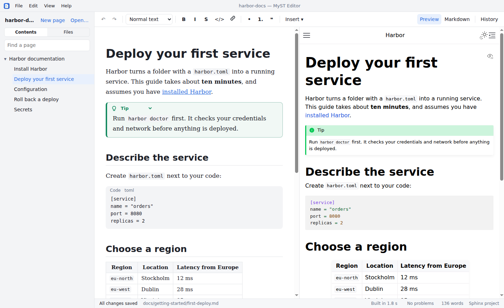

# MyST Editor

A WYSIWYG editor for Sphinx documentation written in MyST Markdown, for writers who
shouldn't have to see Markdown syntax. Only what you change is saved; the rest of
every file stays exactly as written.

<picture>
  <source media="(prefers-color-scheme: dark)" srcset=".github/showcase-dark.png">
  
</picture>

Downloads: [releases](https://github.com/erladion/myst-editor/releases).

## Install

- **RHEL 9, Rocky/Alma, Fedora:** `sudo dnf install ./MyST-Editor-<version>-x86_64.rpm`
- **Debian, Ubuntu, Mint:** `sudo apt install ./MyST-Editor-<version>-amd64.deb`
- **Other Linux:** the AppImage (needs `libfuse2`, or run it with `--appimage-extract-and-run`).
- **Windows:** `MyST-Editor-Setup-<version>.exe`. It's unsigned, so Windows warns the
  first time (**More info → Run anyway**). On managed PCs, run it as administrator.

Git features need `git` (Git for Windows on Windows).

The app can build with a Python environment that's already there, so nothing is
downloaded. Make one from wheel files and choose it in the app (a `.venv` in the
project is found automatically):

```sh
python3 -m venv docs/.venv
docs/.venv/bin/pip install --no-index --find-links /path/to/wheels -r docs/requirements.txt
```

It needs Sphinx 5.3 or later, MyST-Parser, and every extension `conf.py` uses.

## Using it

Open a documentation folder, **Get from a repository…** to clone one, or **New
project…** (File → New Project…) to start one: a Sphinx project with a first page,
optionally as a git repository. The first
time, the app asks whether to build it with Sphinx, which runs the project's
`conf.py`, and where Python should come from:

- an environment on the computer (a project `.venv`, or the system Python), or
- a private one the app sets up, from the project's requirements (needs internet once).

Builds then run in the background after every save, for links, problems and
previews. Right-click a page in the sidebar to see its history, rename or move it (links and
tables of contents pointing to it follow), delete it, or move it in the contents (or
drag it).

**Git:** the status bar shows the branch and your changes, and checks the server
every few minutes ("↓2 new"). Click the changes to commit, push, see or discard them,
and **Get latest**: your commits go on top of what's new (a rebase) and uncommitted
edits are kept. Where you and a colleague changed the same lines, the app asks, place
by place, what to keep. Click the branch (or Ctrl+Shift+B) to switch branch, or start
one from the latest `main`; uncommitted changes can stay with the branch you leave
and come back when you return. Pull requests stay in your git server.

Help → Keyboard Shortcuts lists them all; the main ones:

| Shortcut | |
|---|---|
| Ctrl+B, Ctrl+I, Ctrl+E | Bold, italic, code |
| Ctrl+K | Link |
| Ctrl+Alt+1 to 4 | Title, heading, subheading, small heading |
| Ctrl+Shift+N (or Ctrl+Alt+0) | Normal text |
| Ctrl+Shift+L (or Ctrl+Shift+8), Ctrl+Shift+7 | Bulleted, numbered list |
| Ctrl+Alt+N | Callout (a note) |
| Ctrl+Shift+K | Cross-reference |
| Ctrl+Shift+G | Figure |
| Ctrl+Shift+T | Table |
| Ctrl+Shift+E | Code block |
| Ctrl+P | Go to page |
| Ctrl+N | New page |
| Ctrl+Shift+O | Outline of the page |
| Ctrl+/ | Markdown view |
| Ctrl+F | Find and replace in the page |
| Ctrl+Shift+F | Search all pages |
| Ctrl+Shift+B | Switch branch |

Insert → Table (Ctrl+Shift+T) shows a grid to choose its size, as in Word. Right-click in
a table to add or delete rows and columns (or merge and split cells).
A figure gets a name when it's inserted (from its caption, or the one you give), shown
on its card as `#name`: Insert → Cross-reference refers to it by that name (the link
shows its caption; with `numfig = True` in `conf.py`, "as Figure 2" numbers it). An
image can be referred to too: choose "An image on this page", and a link target is put
before the image if it has none (an image has no caption, so the link has its own
text).

**PDF:** File → Export PDF… builds the whole project as one PDF: a cover, one table
of contents with page numbers, then the pages in the order of the contents (each
top-level entry starting a new page), with PDF bookmarks for every heading. It uses
the project's Sphinx with a plain print layout instead of its HTML theme, and Chromium
(in the app) to print, so nothing else needs installing. A manual of 400 pages takes
about a minute. File → Project Settings sets it up (`[pdf]` below): the paper; the
cover, on a preview where graphics are dragged into place (a background to the page's
edges, the logo, title, subtitle, a note, and any graphics, all of which can be moved); the fonts (font files in
the project are put in the PDF, so it looks the same everywhere); the headers and
footers; and the page numbering.

View → Appearance switches between light and dark. The menus are in the title bar;
View → Use System Title Bar puts them back in a menu bar of their own.

**Vale:** if [Vale](https://vale.sh) is installed and a `.vale.ini` applies to the page,
the page is checked after each save. Remarks are underlined; click one for what Vale
says and its corrections. The status bar shows how many there are (click to go to the
next). **Accept** adds a word Vale gets wrong to the project's Vale vocabulary
(`accept.txt`; without one, `Vocab = Project` is added to `.vale.ini`), so Vale
accepts it everywhere.

**Emacs keys:** Edit → Emacs Keys switches them on, in both views. The menu then
leaves these keys alone; fields in dialogs keep their usual keys.

| Keys | |
|---|---|
| C-f / C-b, C-n / C-p | Forward / back a character, down / up a line |
| M-f / M-b | Forward / back a word |
| C-a / C-e | Start / end of the line |
| M-< / M-> | Start / end of the page |
| C-v / M-v | Down / up a screen |
| C-SPC | Set the mark (moving then selects) |
| C-d | Delete the next character |
| M-d / M-DEL | Kill the next / previous word |
| C-k | Kill to the end of the line |
| C-w / M-w | Kill / copy the selection |
| C-y | Yank (one kill ring for both views) |
| C-o | Open a line |
| C-t | Swap two characters |
| C-x h | Select all |
| C-/ | Undo |
| C-s / C-r | Find forward / back |
| C-g | Cancel |
| C-x C-s | Save |
| C-x b | Go to a page |
| C-x C-f | Open a folder |
| C-c C-s b / i / c | Bold / italic / code |
| C-c m | Markdown view |

## Project settings

A `.mysteditor.toml` next to `conf.py` (or at the top of the folder, for all its
projects) tells the editor about the project's own extensions. It's reloaded when
saved, and mistakes show as "Settings: N problems" in the status bar. Everything is
optional. **File → Project Settings…** turns conditional content on or off and sets it
up, writing into this file without touching the rest of it.

```toml
# A directive, edited like a callout with a form for its options.
[directives.company-callout]
label = "Internal note"
tone = "warning"          # note | info | tip | warning | danger | neutral
body = "markdown"         # markdown | text (edited as code) | none (a card)
argument = "Title"        # leave out if it takes no argument
insert = true             # offer it in the Insert menu
[directives.company-callout.options.audience]
label = "Audience"
help = "Who it's for"
choices = ["internal", "partners", "public"]
default = "internal"
[directives.company-callout.options.draft]
flag = true               # a checkbox

# A role: a labelled chip; Ctrl+click opens the link.
[roles.jira]
label = "Jira"
url = "https://jira.example.com/browse/{value}"

# Merged table cells, written {colspan}`2` text, with covered cells empty.
[tables]
colspan_role = "colspan"
rowspan_role = "rowspan"

# Conditional content: <!-- if: X or Y --> … <!-- endif --> and
# <!-- if-inline: X --> … <!-- endif-inline -->.
[conditions]
enabled = true                       # false turns it off, keeping these settings
capabilities = "capabilities.json"   # relative to this file
key = "product.capabilities"         # where the names are in it (optional)
block = ["if", "endif"]
inline = ["if-inline", "endif-inline"]
case_sensitive = true
[conditions.colors]                  # optional
CapabilityX = "teal"                 # purple, orange, teal, magenta, blue, olive, green, slate or "#rrggbb"

# File → Export PDF. {page} {pages} {chapter} {title} {date} {version} {logo} can be
# used in the cover's texts and in the headers and footers.
[pdf]
paper = "A4"                         # A4 | Letter
logo = "_static/logo.svg"            # relative to this file: on the cover, and {logo}
title = "Harbor manual"              # the cover's; default: the root page's title
subtitle = "Version {version}, {date}"
note = "© Example AB"                # at the foot of the cover
cover_background = "_static/cover.png"   # fills the cover page to its edges
cover_color = "#ffffff"              # the cover's text, on a dark background
cover_images = [                     # mm from the page's top-left corner
  { file = "_static/badge.svg", x = 150, y = 240, width = 40 },   # height optional
]
font = "Source Serif 4"              # the text: a font in fonts, or on the computer
heading_font = "Source Sans 3"       # headings and the cover's title; default: font
code_font = "JetBrains Mono"
fonts = ["_static/fonts/SourceSerif4-Regular.ttf", "_static/fonts/SourceSerif4-Bold.ttf"]
header = ["{logo}", "", "{chapter}"] # left, centre, right
footer = ["", "{page}", ""]
headers_on = "numbered"              # numbered | not-cover | all: on which pages (slots
                                     # with {page} or {pages} stay empty on unnumbered ones)
numbering = "content"                # from the first chapter (the pages before it
                                     # are unnumbered) | cover
toc_depth = 2                        # levels in the contents

# The cover's logo, title (with the subtitle under it), subtitle and note, moved from
# their usual places (dragged there in Project Settings): mm from the page's top-left
# corner; width in mm; for the texts, size in points and align (left, center, right).
[pdf.cover.title]
x = 20
y = 150
size = 36
align = "center"

# Environment variables for Sphinx builds (writers can add their own in the app).
[sphinx.env]
PRODUCT = "enterprise"
```

Directives and roles that aren't declared still work: they're kept exactly as
written, shown as cards with a preview from the build, and editable as source.

Conditions can also wrap table rows (markers between the rows; set them with **Row
condition…** in the table toolbar). New capabilities can be added from the condition
dialog: they're written into the capabilities file.

## Known limitations

- Some blocks are cards, edited as source: list and CSV tables, grid tables, tables
  of contents, includes, glossaries, rubrics, definition lists and footnotes. Table
  cells hold one line.
- The Insert menu offers the standard MyST and Sphinx directives. Ones from
  extensions or themes (sphinx-design's tabs and grids, margin notes, your own) show
  in pages, but are only in the menu once declared in `.mysteditor.toml`.
- Search all pages finds text; replacing is one page at a time (Ctrl+F). In the
  formatted view, find skips blocks shown as cards (the Markdown view finds those).
- Syntax an extension finds in the raw text (say `[[...]]`), rather than through a
  role or directive, is ordinary text to the editor and may get escaped when its
  paragraph is edited.
- Previews show the last saved build, about a second behind typing.

## Development

```sh
npm install
npm run fetch-uv       # the bundled uv, checksum-verified
npm run dev            # the app, with hot reload
npm run typecheck
npm test               # unit tests
npm run test:sphinx    # integration: real uv, Sphinx and git
npm run test:e2e       # the built app, driven by Playwright
npm run dist           # AppImage, RPM and .deb in release/ (RPM needs rpmbuild)
npm run dist:win       # Windows installer (on Windows)
```

On WSL or a minimal Linux, Electron may need `libasound2t64`, and the AppImage
`libfuse2t64`. If `npm run dev` starts Electron as plain Node, unset
`ELECTRON_RUN_AS_NODE`.

**Releasing:** CI runs all tests on Linux and Windows for every push. To release,
bump the version and push a matching tag; the release workflow tests, builds every
package and publishes them:

```sh
npm version 0.6.0 --no-git-tag-version
git commit -am "Release 0.6.0"
git tag -a v0.6.0 -m "MyST Editor 0.6.0"
git push origin master v0.6.0
```
